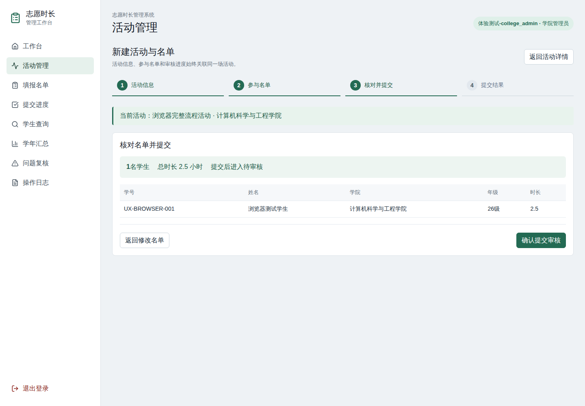
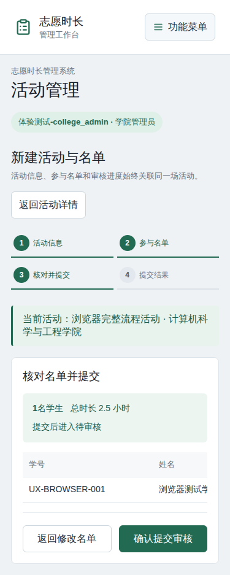
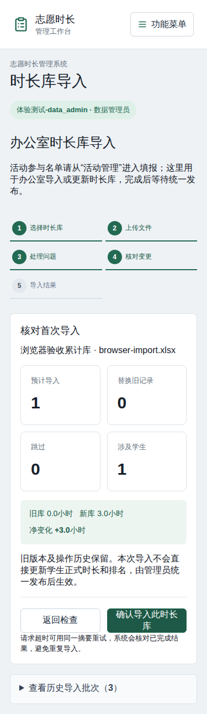
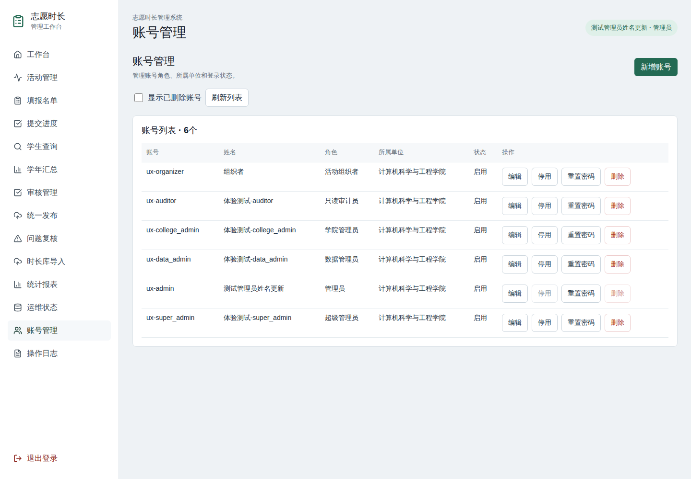

# 用户体验重构开发与验证记录

日期：2026-10-13。开发分支：`codex/ux-refactor-20261013`。交付方式：PR，由用户审核；本轮未修改生产服务、生产数据库或云端镜像。

## 已实现的行为

| 范围 | 本轮改动 |
| --- | --- |
| 权限与入口 | 当前用户接口返回数据库中的最新身份、能力与范围；菜单、工作台和操作按钮按能力展示，越权直达页面回到工作台 |
| 会话 | 停用、删除、密码重置及角色/单位变化使旧会话失效；普通姓名编辑保留会话；刷新Token不能用于访问业务接口 |
| 账号管理 | 新增、编辑、启停、重置密码、逻辑删除和恢复；保护当前登录账号和最后一个管理员，恢复后先保持停用 |
| 活动管理 | 列表、筛选、详情、名单与进度；空活动可以删除和恢复，有有效名单的活动需先撤回/作废记录或归档 |
| 活动名单 | 活动信息→名单录入→校验预览→提交审核→结果；支持手工录入、Excel粘贴、模板上传，返回上一步保留输入 |
| 时长记录 | 驳回原因、修正重提、带原因撤回/作废/恢复与审核；有效状态统一为待审、通过、驳回，退休记录保留审计 |
| 导入 | 选库→上传→问题处理→变更摘要→结果；稳定数据集标识、显式跳过、问题清单下载、确认回执和重复请求核对 |
| 累计库更新 | 替换旧版本时保留批次与原记录；相同文件可按新默认值更新已有库；文件哈希唯一性限定当前版本 |
| 公示 | 修改、作废、导入不会立即改动当前公示；统一发布时重新计算正式时长和排名；详情区分通过待发布与已发布 |
| 手机 | 可折叠功能菜单，375px下的活动与导入流程无整页横向溢出；表格在自身区域滚动 |

学院账号的活动仍限本人创建，名单与查找按所属学院约束；组织者限本人活动和提交；数据管理员负责审核、导入和复核；审计员的复核页只提供查看。admin与super_admin继续沿用既有全权限定义。

历史日期未知的记录仍保持未知；恢复时不会因缺少日期而把两个历史来源误判为同一活动。扣减调整和普通时长分别检查重复，已替换时长库的旧记录不能直接恢复为有效版本。

## 实际验证

验证全部在服务器开发目录执行，使用专用PostgreSQL容器与合成账号、名单；没有以测试结果代替真实业务表格对账。

| 检查 | 结果与范围 |
| --- | --- |
| 原有 `npm test` | 六组回归通过：健康/参数、导入、限流、学院名称、产品行为、学年规则 |
| UX真实数据库集成 | 12组通过：六角色、会话、权限边界、资料编辑、并发提交、删除/恢复、作废与公示隔离、历史/扣减恢复、同文件更新、版本绑定、最后管理员竞争、缓存离线 |
| 学年集成 | 正负时长、累计更新/归零、防重、联合查找、身份修正、日期归类、排名分页及角色边界通过 |
| 月度发布集成 | 待审阻止发布、批准等待发布、版本切换、重复发布、字段脱敏、排名与SQL一致及并发缓存切换通过 |
| 浏览器 | 六角色共56组角色/页面组合；未出现可见页面发出越权请求或JS异常；活动到待审、导入到结果、账号删除/恢复、直达链接兜底及返回保留输入通过 |
| 手机浏览器 | 375px活动预览、导入步骤与摘要、菜单展开/收起通过；截图见下方 |
| 两套前端 | 管理端与查询端服务器构建通过 |
| 后端打包 | 复用服务器既有依赖镜像构建独立review镜像，无网络安装；迁移加载、健康200和未登录账号管理401烟测通过 |
| 镜像兼容SQL | 在隔离PostgreSQL中测试enum/text两类status结构与重复应用，均通过；未在Supabase执行 |

原有权限测试改用不同的数据库账号作为角色夹具，避免通过修改同一个管理员Token的role来模拟权限。

验证摘要保存在 [validation-summary.json](ux-refactor-20261013/validation-summary.json)，原始日志留在服务器开发目录的 `ux-checks/`，不提交带上下文的原始日志。

## 一个完整的实际用例

浏览器用合成学院管理员登录→创建“浏览器完整流程活动”→填写合成学生学号、姓名、年级与2.5小时→校验预览→返回修改页确认输入仍在→再次预览并提交→详情显示待审核。

数据管理员另用合成xlsx文件完成首次累计库导入，核对新增1条、时长3小时的摘要后查看结果页。管理员通过页面删除合成组织者账号，再从已删除列表恢复，验证其处于停用状态。

这些是实际执行的隔离测试，不是生产操作；参与者、名单与截图数据均为合成。

## 截图

活动预览（桌面）：

活动预览（手机）：

导入变更摘要（手机）：

账号管理：

## 迁移与审阅要点

主库迁移为 `backend/src/db/migrations/008_user_experience.sql`，新增会话版本、逻辑删除、记录生命周期、提交防重和数据集字段，并增加withdrawn/voided状态。原有记录保留，既有账号会话版本默认为0。

累计批次保留旧版本，需要将原来的全历史文件哈希唯一索引改为当前版本唯一索引。旧批次按原备注生成稳定legacy标识，后续操作通过标识关联。

镜像兼容迁移为 `supabase/migrations/202610130001_user_experience_mirror.sql`。现有同步会导出全部字段，因此上线前需要镜像先支持这些字段与状态；该SQL保留RLS及其他业务约束。本轮只准备SQL并作隔离验证，主库生产迁移、云端迁移、镜像同步和发布均未执行。

GitHub main缺少服务器开发分支里的学年汇总、月度统一发布和历史日期修正。本PR包含这些既有基线；本轮体验改动单独提交，审阅时可按提交区分。合并冲突已保留两边意图并通过原回归。

本轮验证复用既有依赖，没有进行冷环境依赖安装。跨会话名单草稿仍属于后续增强；当前提供流程内输入保留与离开提醒。真实业务表格、学校分期规则与真人试用需要在审核后的上线准备阶段确认。

## 后续操作边界

当前交付为代码、迁移、截图与验证证据。用户审核PR后再决定合并；生产迁移与发布另行按授权流程执行。

## Copilot审查后的修复与回归

针对PR #1在提交`64447ab`上的四条意见逐一复现，四条均成立。旧测试先运行全部SQL迁移，未覆盖Compose只初始化001后的实际启动，现已补齐。

| 审查意见 | 修复与实际验证 |
| --- | --- |
| 启动遗漏002—004迁移 | 按顺序运行完整迁移链；空库先初始化001，既有库保留数据；同一数据库的并发初始化通过迁移锁串行执行 |
| 校验码匹配了草稿版本 | 校验码从当前公示快照匹配，返回同一快照的批次、正式时长与记录；学号和姓名查询继续使用草稿。草稿改动后原公示码仍可查询，下次发布后切换到新码 |
| 编辑使用加锁前的旧数据校验 | 在事务中按活动→记录的顺序加锁，读取完整记录后再检查状态、权限与字段；并发作废/撤回返回409，并发补齐真实日期后不能再清空日期，审校历史记录最新提交前的值。校验拒绝时回滚并释放连接 |
| 导入查重遗漏待审核与驳回记录 | 预览、变更摘要及最终确认统一检查pending/approved/rejected；已撤回/作废历史允许重新导入。最终确认也检查初次规范化之后新增的待审核记录，阻止重复有效时长 |

新增`startup-regression.js`的4组启动回归，以及`review-regression.js`的8组数据库/API回归，共12组。修复前11组失败、1组通过；修复后全部通过。并发编辑用两个真实PostgreSQL事务和锁等待复现，未替换数据库行为。

原有六组`npm test`、12组UX集成、学年集成与月度发布集成在服务器重跑通过。独立review镜像复用服务器已有依赖、禁用网络安装；专用空数据库仅加载001后，实际执行`src/app.js`启动与再次启动均通过，健康接口200、未登录账号接口401，六角色、计数器与公示指针齐全。

安全摘要：[copilot-review-regression.json](ux-refactor-20261013/copilot-review-regression.json)。原始日志仍留在开发目录`ux-checks/`，未提交生产数据、凭据或原始请求日志。

复跑新增脚本前，应新建只用于测试的`ux_startup_test`和`ux_review_test`数据库，均连接localhost/127.0.0.1。分别通过`STARTUP_TEST_DATABASE_URL`和`REVIEW_TEST_DATABASE_URL`指定连接；设置测试用`JWT_SECRET`及`REVIEW_TEST_PASSWORD`后执行`npm run test:startup`、`npm run test:review`。启动回归会重建其专用库中的public schema；脚本会拒绝其他库名或非本机地址。

本次继续更新原PR供用户审核，未合并或部署；未操作生产目录、生产容器、生产数据库和Supabase。

## 2026-10-14：公示只读、导入学年与并发恢复

对固定版本`1646a229`的三个问题完成代码核对与实际复现，均成立。本次修复继续提交到原PR #1，等待用户审核。

| 问题 | 修复与实际验证 |
| --- | --- |
| 公示快照覆盖审核库更正 | 校验码结果标为只读，页面隐藏编辑入口，保存入口再次检查；更正需按学号/姓名查询当前审核库。查询方式切换清理编辑态，过期异步响应不能恢复旧结果 |
| 默认日期补齐后仍使用预览学年 | 预览保留学年是明确填写还是推断的标记；推断学年在最终日期补齐后重新分类。显式学年、管理员默认学年、期间写明的学年保持原优先级，累计记录的待确认阶段保留 |
| 相同导入记录并发恢复重复累计 | 所有恢复事务在活动/记录锁之前取得现有导入事务锁，与导入确认共用查重和写入保护；两位审核人员并发恢复只允许一条成功，另一条409；恢复与重导并发也只留一条有效记录 |

实际浏览器用合成公示2.5小时、审核库已更正4.5小时的记录复现：旧页面通过校验码只修改年级，就将审核库写回2.5小时。修复后公示仅供核对，学号查询显示4.5小时；修改年级后时长仍为4.5小时。编辑期间切换查询方式会清理表单，延迟返回的旧查询结果也不会再显示。

新增`private-review-regression.js`有11组数据库/API回归；另执行5项浏览器检查。原版本数据库6/11失败、浏览器4/5失败，修复后16项全部通过。并发验证用真实PostgreSQL表锁暂停写入，观察两个事务分别等待写入/共同事务锁后再放行，没有替换数据库结果或依赖随机竞态。

重跑此前12组启动与审查回归、原12组UX集成、六组`npm test`、学年与月度发布集成，均通过。管理端使用服务器已有依赖重新构建通过；独立后端review镜像在仅初始化001的专用库上实际启动、重启通过，health 200、未登录users 401。未安装依赖。

摘要：[review-followup-20261014.json](ux-refactor-20261013/review-followup-20261014.json)。复跑新增数据库脚本时，先新建本机专用`ux_private_review_test`，设置`PRIVATE_REVIEW_TEST_DATABASE_URL`、合成测试密码`PRIVATE_REVIEW_TEST_PASSWORD`及测试`JWT_SECRET`后执行`npm run test:private-review`。脚本拒绝其他库名和非本机地址，测试夹具需要空数据库。

本次共同锁覆盖恢复与恢复、恢复与导入确认。在线新提交、复核改键和活动同步沿用既有校验机制；这里没有引入全库唯一索引，也没有把该锁描述为所有写入口的唯一性保证。生产服务、生产数据和Supabase未改动；按用户要求保持Copilot复审停止。

## 2026-10-14：跨来源恢复、已删除活动与名单离开提醒

固定版本`6ef4b780`的三项问题均在服务器隔离环境实际复现并修复，继续更新原PR #1等待用户审核。

| 问题 | 修复与实际验证 |
| --- | --- |
| 在线记录恢复漏查未关联的导入记录 | 恢复同时按关联活动及学生、活动名称、真实日期检查有效重复；调整属性、时长和原因沿用导入口径。待审、通过、驳回的导入记录均会阻止重复恢复，普通时长与扣减仍分别判断；未知日期的历史来源继续保持独立 |
| 复核关联了逻辑删除的活动 | 解析候选排除`deleted_at`非空的活动，并在事务中持有共享行锁至提交。候选被更新或删除时返回409并回滚本次编辑，重试后关联有效活动；新关联建立后，活动删除因有效名单被拒绝 |
| 保存活动信息清除了未提交名单提醒 | 分别记录活动表单和名单的未保存状态；保存活动只清除表单状态，名单提交成功才清除名单状态。返回上一步再保存后，切换模块和关闭页面仍提醒，取消离开后输入保留 |

实际例子：合成在线记录2.5小时通过后作废，再导入同学生、同活动名称和日期的2.5小时记录。旧代码允许恢复并在统一发布后累计为5小时；修复后恢复返回409，公示仍为一条记录、2.5小时。

新增`lifecycle-review-regression.js`包含8组真实PostgreSQL/API回归，另执行7项真实管理端浏览器检查。旧代码数据库5/8失败、浏览器3/7失败；修复后15项全部通过。数据库竞争通过另一事务锁定候选活动后再删除复现，验证409时原时长和审校记录均回滚；随后重试关联有效活动。候选锁使用`FOR SHARE NOWAIT`，避免在已持有记录锁时反向等待活动锁。

浏览器验证包含活动信息再次保存后模块切换确认框及原生`beforeunload`关闭提示、取消离开保留输入、空白未修改名单不提醒、名单提交后落库并清除提醒，以及保存失败继续提醒。保存失败场景仅注入HTTP 503，其他流程使用真实后端、专用测试库及合成名单；没有浏览器JavaScript异常。

此前23组启动/审查数据库回归和5项公示查询浏览器检查、12组UX集成、六组`npm test`、学年与月度发布集成重跑全部通过。管理端服务器构建及独立后端review镜像打包、仅初始化001后的实际启动和重启通过（health 200、未登录users 401），复用既有依赖，没有安装软件。

安全摘要：[review-followup-20261014-2.json](ux-refactor-20261013/review-followup-20261014-2.json)。复跑新增数据库脚本时，新建本机专用空库`ux_lifecycle_review_test`，设置`LIFECYCLE_TEST_DATABASE_URL`、合成测试密码`LIFECYCLE_TEST_PASSWORD`及测试`JWT_SECRET`，执行`npm run test:lifecycle-review`。脚本拒绝其他库名和非本机地址。浏览器与构建的原始证据留在服务器开发目录`ux-checks/`。

本次未合并、部署或修改生产与Supabase，Copilot复审继续保持停止；跨会话名单草稿仍保留为后续增强。

## 2026-10-14：修正重提、历史名称与镜像批次同步

固定版本`c5632762`的三项问题均已通过服务器隔离数据库及实际浏览器复现，修复继续更新原PR #1供用户审核。

| 问题 | 修复与实际验证 |
| --- | --- |
| 修正重提漏查未关联活动的导入记录 | 恢复与重提共用有效记录查重函数，核对关联活动或同学号、活动名称、真实日期及调整属性；使用校验后的新学号和时长，排除当前记录自身。重提在活动和记录锁之前取得现有导入事务锁；普通名单提交与预览同时补齐跨来源查重，提交也参与共同事务保护 |
| 后台更正改写历史原始名称 | 当前审核库查询保留原始`activity_name`，编辑表单据此初始化；年级或时长单项更正后原名称与未知日期保持。学生公示继续使用“累计时长记录”等展示文案，公示校验码保持只读 |
| 同哈希版本更新触发镜像唯一索引 | 导出全部已失效批次在前、当前批次在后，分别按ID稳定排序。切换到当前批次时先完成旧批次的REST上传，即使两阶段在同一分页内也分成独立请求；旧状态上传失败即停止，重试可继续完成 |

实际数据库用例：提交者撤回2.5小时记录，办公室导入同学生、同活动、同日期的2.5小时记录，再修正重提。旧版本重提成功，批准并发布后累计5小时；修复后重提被拒绝，正式公示仍为一条记录、2.5小时。两种受控并发顺序分别让重提或导入先到达写入锁：修复后另一写入口等待共同事务锁，最终均只有一条有效记录。

新增`resubmit-review-regression.js`的11组真实PostgreSQL/API回归、`tools/sync-supabase-regression.py`的5组镜像同步回归及4项真实管理端浏览器检查。旧版本分别9/11、4/5、3/4失败；修复后20项全部通过。既有产品测试更新为后台编辑保留原名称的契约；学生公示的友好名称另由真实数据库发布回归验证。

镜像验证使用专用源库、镜像库、实际镜像兼容SQL和真实`idx_import_file_hash`，REST端为本机测试服务器；请求内的行故意按ID重新排序，验证两阶段分开上传后不依赖批量请求内部处理顺序。覆盖新UUID早于旧UUID、分页大小1/2/2000、多组版本替换、首次与重复同步、旧状态上传失败及重试恢复；后续志愿记录也成功同步。没有连接云端Supabase，测试不代表云端RLS或部署验收。

此前31组启动/审查回归、12组UX集成、六组`npm test`、学年与月度发布集成，以及5项公示只读查询浏览器检查全部重跑通过。独立后端review镜像在仅初始化001的专用库上实际启动与重启通过（health 200、未登录users 401）。本次管理端源文件未变，浏览器复用上一轮服务器构建的资源；未安装依赖。

摘要：[review-followup-20261014-3.json](ux-refactor-20261013/review-followup-20261014-3.json)。新增API脚本需要本机专用空库`ux_resubmit_review_test`，通过`RESUBMIT_TEST_DATABASE_URL`、合成密码`RESUBMIT_TEST_PASSWORD`和测试`JWT_SECRET`配置后执行`npm run test:resubmit-review`。镜像脚本要求标签为`task=ux-refactor-20261013`、端口`127.0.0.1:55434`的专用`volunteer-ux-db`容器及空的`ux_sync_source_test`、`ux_sync_review_test`库；在两个测试库应用主库迁移，并在镜像库应用镜像兼容SQL，再设置`MIRROR_TEST_CONTAINER`、`MIRROR_TEST_SOURCE_DATABASE`、`MIRROR_TEST_DATABASE`后运行`python3 tools/sync-supabase-regression.py`。测试只使用合成数据，源库与镜像库夹具会清空其导入批次和关联记录。

共同事务保护本轮覆盖恢复、重提、普通名单提交与导入确认；复核改键和活动同步继续使用既有活动/记录锁。未增加数据库唯一索引或迁移，生产与云端镜像未修改，未合并或部署；Copilot复审仍保持停止。
