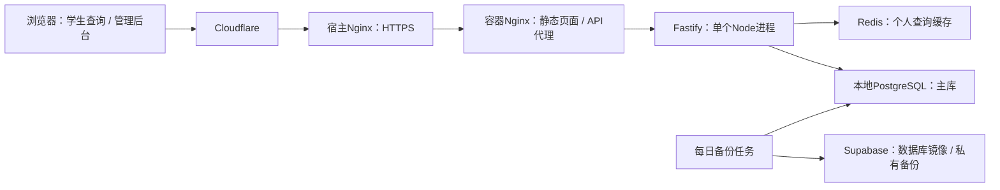

# 项目概览与服务器压力评估

评估日期：2026-10-12，北京时间约20:40—21:00。评估对象：`zysc.hanyao.me`、服务器上的 `/opt/volunteer-system`。本次检查实际部署代码和资源，未安装工具、未重建正式系统、未修改业务数据。

## 结论

**后续实施更新（2026-10-12 22:52）：** 用户确认按月发布最新累计库，学院先提交、学生可查审核进度、全部审完后统一发布。现已上线持久发布快照和预计算排名、取消30秒轮询，并调整校园出口查询计数及Nginx连接预算。2000人私有数据副本的完整HTTP测试为4000次200，P95约19秒、最慢19.5秒；这是服务器内成绩，公网和3000人场景仍未验收。操作与新证据见 `月度统一发布与审核进度.md`。下文未标为实施更新的配置和性能数字保留为优化前基线。

当前负载很轻，没有立即扩容的依据。服务器为8个逻辑CPU、约8 GB内存；目前数据库约26.5 MiB、34,277条志愿记录，数据规模小。公示后集中查询的主要成本来自首次查询、学年归类和汇总排名计算。公网体验还需要分别检查网络路径和HTTPS连接耗时。

短时业务函数测量通过，不能据此承诺整站最大并发、持续吞吐或全校同时查询的服务等级。

## 一、正式系统如何工作

- `/query/`：学生通过学号、姓名查询审核通过的记录；查看个人明细、学年汇总、同学院同年级的脱敏排名。
- `/admin/`：人员查找、信息修正、活动管理、加减时长、审核、Excel预览与导入、统计及权限管理。
- `/status/`：展示API、主库、Supabase、备份和原始来源文件的状态。
- 普通查询直接访问本地主库；Supabase不在个人查询的必经链路。每日备份服务先保存/上传备份，再执行数据库镜像同步；它不代表每次修改都立即同步到镜像。
- 个人查询缓存有效期300秒，缓存键包含数据版本。学年汇总接口目前没有结果缓存，重复访问仍计算汇总和排名。
- 已查询且页面可见时，每30秒检查数据版本；后台标签页暂停轮询。发现版本变化后重新取得查询结果。
- 公开个人查询和汇总接口配置每IP每分钟10次；默认API限流每IP每分钟100次。共享校园出口的实际体验需要另外验收。

## 二、Demo清理结果

- 已删除服务器 `/opt/volunteer-system-beta-releases`，包括两次演示发布的源码、依赖、构建产物和脚本。
- `/beta`、`/beta/`及旧JS资源公网均返回404；正式管理端、查询端和状态页为200。
- Nginx撤下前配置保存在 `/opt/volunteer-system-release-backups/20261012T124229Z-beta-removal/nginx-before.conf`。
- 本机递归删除被执行工具策略拒绝，未执行成功；已将 `frontend-demo/` 移到 `work/retired-demo-20261012/`，退出项目主目录。此处保留的是停用资料，不参与生产部署。

## 三、当前服务器压力

| 项目 | 实测 | 判断 |
| --- | --- | --- |
| 逻辑CPU | 8个；负载约0.20 / 0.18 / 0.11 | 平时余量充足 |
| CPU采样 | 约0—3%忙碌；I/O等待为0 | 未见持续CPU或磁盘瓶颈 |
| 内存 | 总计7.75 GiB，可用约6.46 GiB | 当前内存充足 |
| 志愿系统四个容器 | 基线合计约175 MiB | 当前应用占用小；不包括宿主缓存及其他服务 |
| 磁盘 | 总计49 GiB，已用约27 GiB，剩余约22 GiB，使用率约55% | 当前空间充足 |
| 主库逻辑大小 | 27,778,071字节，约26.5 MiB | 很小；主库物理目录约82 MiB |
| 业务规模 | 34,277条记录、8,831个学号姓名组合、5,239个活动、1个导入批次 | 总人数与同时在线人数不同 |
| 数据库连接 | 基线1个空闲连接，另1个为评估查询；应用连接池上限10 | 当前没有连接堆积 |
| Redis | 约1 MiB，基线仅2个连接 | 当前占用很小 |
| 过去24小时容器Nginx日志 | 160个回源请求；最高27个/分钟，公开个人查询接口仅1次请求 | 含扫描与跳转；不是160名用户，也不是边缘缓存总访问量 |
| 容器异常 | 四个正式容器重启计数0，OOM标记false | 本次未见容器内存崩溃 |
| 备份 | 最近任务成功，公开状态显示约18小时前生成 | 当前正常 |

同机还有考研工具、WordPress、MariaDB以及其他宿主进程，整机容量由这些服务共同使用。CPU、内存及流量采样仅覆盖短时间，不能替代长期峰值监测。

## 四、短时业务测量

使用实际生产容器中的服务模块，在独立Node子进程内访问现有数据库，采用单独的10连接池。没有伪造客户端IP或解除限流。测试最多10个并发服务调用，总计245次函数调用；另有3次真实汇总HTTP请求，均为200。没有导入、调整或新增业务记录，也没有通过个人查询HTTP接口增加查询计数；正常Redis查询缓存得到短暂预热。

| 路径 | 并发 / 样本 | 中位耗时 | 95%完成耗时 | 结果 |
| --- | --- | --- | --- | --- |
| 学年汇总，串行 | 1 / 15 | 50.6 ms | 83.5 ms | 0错误 |
| 学年汇总 | 5 / 40 | 77.7 ms | 153.0 ms | 0错误 |
| 学年汇总 | 10 / 60 | 94.5 ms | 182.0 ms | 0错误 |
| 首批不同学生查询 | 5 / 20 | 109.3 ms | 233.8 ms | 0错误 |
| 同一学生缓存查询 | 10 / 80 | 11.1 ms | 19.3 ms | 0错误 |
| 数据版本检查 | 5 / 30 | 2.7 ms | 5.3 ms | 0错误 |

样本选择现有记录最多的学院年级组合，共2,891条记录；对应样本学年排名460人。不是所有学院、年份及数据分布的最坏情况。测量只持续数秒，业务函数数据不包含完整公网HTTP、限流、真实查询计数写入、浏览器或长期运行成本。

有限并发期间全机CPU忙碌曾约57%，另采到最高17%的CPU steal；短时虚拟CPU调度等待会影响稳定性，不能据此认定长期宿主争抢。未见I/O等待堆积，测量结束后CPU恢复接近空闲。

本机公网补充采样：查询页面单次约3.37秒，JS下载约1.70秒；版本接口新连接约1.51秒，其中TLS累计至约0.87秒，复用连接约0.61秒。它们是当前客户端网络路径的少量样本，不能直接视为数据库耗时、全国用户平均体验或带宽上限。

## 五、压力首先可能出在哪里

1. **汇总和排名的重复计算。** SQL计划约72.8 ms；历史34,277条记录的 `academic_year` 都为空，通过日期、期间和正则表达式计算归属。计划使用Bitmap索引扫描，但仍需要逐条计算、聚合和排名。现有学年索引不能把这个表达式自动变为直接的学年等值查询。建议先评估按版本、学年、学院、年级和分页缓存汇总，保证可见范围和版本失效正确。
2. **首次查询同时到来。** 个人缓存只帮助重复查询；不同学生第一次访问仍要计算个人学年与排名。公示后集中涌入会更接近首查测量，而非缓存测量。
3. **单Node进程与连接池。** CPU有8个逻辑核，当前Fastify只有一个Node进程，连接池默认10。达到瓶颈后才评估进程数、池大小和数据库可用连接预算。
4. **Excel导入。** 当前在同一后端进程加载完整工作簿、转换行并逐行写入，事务锁将导入串行化。上传限10 MB并不等于内存只用10 MB。没有在生产导入数据做压测；大表导入应独立测量，先安排低峰操作。
5. **共享出口限流。** 10次/分钟是每IP的规则，校园NAT可能让多个学生共享限额。429不等于机器满载，需要单独观察并按业务及防滥用要求调整。
6. **资源和日志边界。** 四个容器未配置内存或CPU上限；Redis没有maxmemory、策略为noeviction；没有Swap。Docker日志选项为空，未见显式轮转限制。`/var/log`约3.0 GiB，其中journald约2.6 GiB。当前无异常，建议补齐资源预算、日志轮转及告警，避免其他服务或异常任务占满整机。

## 六、怎样理解人数和容量

| 假设情景 | 平均查询流程到达率 | 当前判断 |
| --- | --- | --- |
| 1,000人在5分钟内查一次 | 约3.3人次/秒 | 从内部短时测量看有较大余量，仍要包括公网完整流程验收 |
| 8,831人在30分钟内查一次 | 约4.9人次/秒 | 数据总人数本身不构成扩容理由；留意实际峰值 |
| 8,831人在5分钟内查一次 | 约29.4人次/秒 | 首次查询加汇总的成本接近需要重点验证的范围，建议先优化并完整压测 |
| 1,000人持续停留在可见结果页 | 约33次版本检查/秒 | 按30秒轮询计算；后台标签页不计入，发布更新时会有重新查询的额外峰值 |

这里是情景算术和基于测量的初步判断，不是最大承载人数。没有确认服务器套餐带宽、运营商路径或持续公网吞吐，暂不承诺万级同时查询。完整压力验收应在隔离环境使用代表性数据，模拟不同学生、共享出口、冷/热缓存、自动刷新、导入和其他共存服务。

## 七、建议顺序

1. 保留目前服务器规格。先记录公示时的请求率、429/5xx、P95延迟、CPU/steal、内存、磁盘、数据库连接等待和慢查询。
2. 优先评估汇总缓存、网络/TLS路径、共享出口限流、日志轮转和服务资源预算。此处为评估建议，本次未调整这些生产配置。
3. 在真实公示高峰前，完成完整HTTP流程及大Excel导入的隔离测试，再决定是否多进程或扩容。

## 八、3000用户与Supabase方案补充

2026-10-12针对3000用户假设进行只读核对。本节没有执行3000用户生产压测，也没有迁移主库或调整生产参数。

### 3000人的不同含义

| 情景 | 对请求的影响 | 判断 |
| --- | --- | --- |
| 3000人打开页面或停留 | 静态资源访问；已查到结果且页面可见时，平均约100次版本检查/秒 | 不等于3000个同时执行的数据库查询，需要验证网络、同步轮询及共享出口限流 |
| 3000人在5分钟内各查一次 | 平均10次完整查询流程/秒；个人查询后还会请求汇总，之后可能轮询 | 内部测量提示存在优化空间，当前尚未完成该完整流程验收 |
| 3000人同一秒提交不同学生查询 | 突发请求、缓存大多未命中、汇总排名和后续轮询同时到来 | 当前配置不应按能稳定支撑来承诺；存在限流、排队、连接失败和超时风险 |

进一步核对实际运行的容器Nginx配置：`worker_processes 1`、`worker_connections 1024`，主进程打开文件软限制1024。连接上限包含客户端和代理上游连接，不能理解为1024名用户；3000个同时在途的请求超出了当前连接预算。[Nginx官方定义](https://nginx.org/en/docs/ngx_core_module.html#worker_connections)。

应用仍为单Node进程、10连接池；个人查询缓存300秒，但不同学生首查仍会计算其学年的排名。共享IP的10次/分钟查询限流可能在CPU用满前就产生429。此前“资源富余、暂不扩容”的结论描述低负载时的硬件余量，不代表当前配置完成了3000同时提交的容量验收。

### 是否改为前端直接使用Supabase

技术上可行：Supabase的Data API支持浏览器直接访问，复杂校验和汇总可放在数据库函数或Edge Functions中，因此可以减少自建Node服务的运维。[Supabase Data API](https://supabase.com/docs/guides/api)。

当前连接的镜像项目实时核对结果：

- 项目 `mnlfwnzulmohdfjcbwbp`，区域 `us-west-2`；所属组织为Free方案。
- 现有主库连接上限60。这个值是数据库连接预算，不是浏览器用户数或HTTP请求并发上限。
- `volunteer_logs`、`activities`、`import_batches`、`users`均开启RLS；现有相关策略只授予 `service_role`，目前浏览器角色不能按现有设计直接查询。
- 未发现名称含 `query` 或 `summary` 的公开数据库函数，现有业务API尚不能通过改一个前端地址完成迁移。
- 镜像目前由定时任务同步；把查询入口切到它，需要重新定义权威主库及更新流程，保证管理端修改后用户看到新数据。

官方Free计算规格为共享CPU、最多0.5GB内存；平台也要求按计算规格、连接和SQL负载规划容量。因此迁到当前Free镜像不能自动证明更强的突发承载能力，也不能用其60个数据库连接推导只能容纳60个用户。[Supabase计算规格](https://supabase.com/docs/guides/platform/compute-and-disk)。

可行的托管形态是“静态前端 → 受控RPC/Edge Functions → 已预计算的查询表”，同时迁移管理员身份与学院权限、导入校验、审计和数据版本更新。前端只能使用公开客户端密钥，结合最小授权及RLS控制访问；现有 `service_role` 或secret密钥不能进入浏览器，学生原始记录也不能整表下载后靠前端筛选。[API安全](https://supabase.com/docs/guides/api/securing-your-api)、[客户端密钥要求](https://supabase.com/docs/guides/getting-started/api-keys)。

### 推荐路线与验收目标

1. 保留现有服务器和正式系统，将汇总排名按数据版本预计算或缓存，查询读取结果；一起处理版本失效、学院范围和个人信息脱敏。
2. 评估Nginx worker、连接和打开文件限制；校准共享出口限流及查询排队预算，不能只增大数据库连接池。
3. 在隔离环境按3000个不同学生完整HTTP流程测试：同秒提交、5分钟分散提交、冷/热缓存、校园共享IP、可见页轮询及版本变更。记录成功率、429/5xx、P95/P99、排队时间与资源。
4. 若目标是减少服务器运维，再单独设计Supabase主库迁移、适合的计算规格及客户端网络验证。现有备份实例继续用于镜像，不作为已验证的并发兜底。

用户已确认本次突发场景允许排队，接受30秒内取得结果。具体验收定义和容量预算如下；它们是目标，尚非当前版本已达到的测量结果。

### 已确认目标：3000人同秒提交，30秒内取得结果

- 以3000个不同学生的有效查询为样本，在同一秒提交；从各自点击查询起计时，排队、服务处理、网络传输和完整查询结果展示计入30秒预算。
- 结果应包括个人时长/明细及所需学年汇总；返回“已排队”或只完成一个SQL，不计为完成整次查询。
- 队列应接收本次3000个有效请求；不能将因共享校园出口误限流的429或连接失败计作容量达标。同步观察管理操作和版本检查的可用性。

容量底线是 `3000 / 30 = 100` 次完整查询流程/秒。若给网络和页面展示保留5秒，服务端需在25秒内处理完成，即至少120次完整流程/秒；保留10秒则需150次/秒。这是容量预算，不是当前测得的吞吐。

此前首批不同学生的内部函数测量约32.2次/秒，单独的10并发汇总约89次/秒；两者都不是完整公网流程吞吐，不能直接相加，更不能据此声称已满足100次完整流程/秒。排队控制同时处理的任务数，吞吐仍决定队尾何时拿到结果。

初步实现方向：

1. 汇总和排名按数据版本提前计算或缓存，多个学生复用同学院同年级结果；按既有权限规则生成个人查询结果。数据更新后按版本切换，避免旧结果继续被当作最新数据。
2. 入口采用有界队列和受控处理并发，将突发请求转为稳定处理；避免3000个任务同时竞争数据库连接。
3. 校准Nginx连接数、进程与打开文件预算，让等候请求能被正常接收；超时配置与30秒业务期限协调，保留管理请求和轮询余量。
4. 前端立即显示“查询中/排队中”，抑制重复提交；在30秒目标内返回完整结果。预计无法按期限完成或队列超限时明确反馈繁忙，避免无期限等待。
5. 用完整HTTP流程验收3000同秒有效请求的成功率、最大等待、P95/P99和30秒内完成比例，覆盖冷缓存、版本切换、校园共享IP及重复点击。验收通过后再确认该目标的承载能力。

结论：允许30秒等待使现有服务器的优化路线更值得验证；当前3.4万条记录的规模支持预计算/缓存方案。现阶段建议保留正式系统，完成上述优化和排队验收后决定是否需要扩容或迁移Supabase。单独延长请求超时，不能证明3000人能在30秒内得到结果。

## 证据与复查入口

- 私有服务器原始汇总：`/opt/volunteer-system/assessments/20261012/assessment.json`，权限600；只含聚合数据和测量，不保存学生姓名、学号或日志原文。
- 采集脚本：同目录 `collect_server.py`、`measure_business.js`。脚本中的数据库测量会预热普通缓存，并产生测试HTTP访问日志；重跑前应确认当前生产负载适合短时测量。
- 核对运行容器与服务器源码：`queryService.js`、`academicService.js`、`rateLimit.js`摘要一致；本地两个业务服务源码摘要亦匹配。
- 正式页面：https://zysc.hanyao.me/query/ 、https://zysc.hanyao.me/admin/ 、https://zysc.hanyao.me/status/ 。
